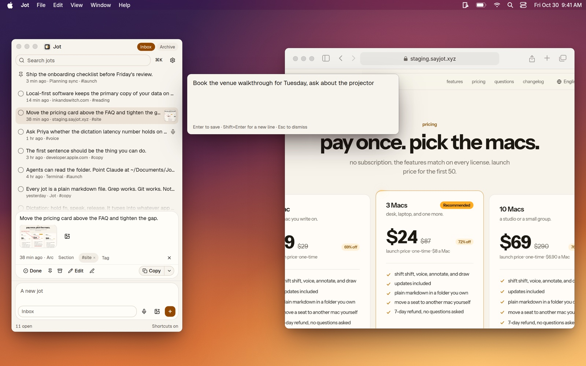

<p align="center"></p>

# Jot MCP server

Jot is a Mac app for quick capture and dictation. Select text in any app and tap Shift twice: it is saved as a plain Markdown file in a folder on your Mac (`~/Documents/Jot` by default). Hold fn to dictate into any app, on device.

`jot mcp` is a local MCP server for that folder. Claude Code, Codex, Cursor and other MCP clients can list, search, read, add, finish, archive and tag your jots. **There is no delete tool**, so an agent cannot remove a note.

- Runs on your Mac over stdio. No account, no cloud, no API key.
- Writes go to the same Markdown files the app shows.
- macOS 12 or later, Apple silicon and Intel.

This repository holds the docs for the MCP server. The server ships inside the Jot app: [sayjot.xyz](https://sayjot.xyz) (free 3-day trial, then a one-time purchase).



## Install

1. Download Jot from [sayjot.xyz/download](https://sayjot.xyz/download) and open it once.
2. Link the CLI (Settings → Vault & Agents can do this for you):

   ```sh
   ln -sf /Applications/Jot.app/Contents/Helpers/jot /usr/local/bin/jot
   ```

3. Add the server to your client.

**Claude Code** (all projects):

```sh
claude mcp add --scope user jot -- /usr/local/bin/jot mcp
```

**Codex:**

```sh
codex mcp add jot -- /usr/local/bin/jot mcp
```

**Cursor, Claude Desktop and other clients:**

```json
{
  "mcpServers": {
    "jot": { "command": "/usr/local/bin/jot", "args": ["mcp"] }
  }
}
```

Settings → Vault & Agents → MCP server → Copy config gives you this JSON. If you did not link the CLI, use `/Applications/Jot.app/Contents/Helpers/jot` as the command.

**HTTP:** `jot mcp --http` serves the same tools on `127.0.0.1:7568` (loopback only by default).

`--vault <dir>` or the `JOT_VAULT` environment variable points the server at another folder, for example an Obsidian vault.

## Tools

| Tool | What it does | Writes? |
|---|---|---|
| `list_jots` | List jots: id, status (open, done, archived), title with #tags, file path. Filter by `tag`, `section`, `done`, `archived`, `limit`. | No |
| `search_jots` | Search open jots by body text, tags, and source app or URL. Case-insensitive. | No |
| `read_jot` | Read one jot: file path, image paths, and the whole Markdown file. | No |
| `jot_image` | One image from a jot, as an image block (vault attachments only, up to 5 MB). | No |
| `add_jot` | Create a jot from Markdown text, with optional `tags` and `section`. | Yes |
| `set_done` | Mark a jot done, or open it again. | Yes |
| `archive_jot` | Archive a jot. It leaves the inbox; the file stays. | Yes |
| `tag_jot` | Add tags to a jot. Existing tags stay. | Yes |

Clients that support MCP Apps also get an inline Jot inbox view, where you can tick, tag, archive and add jots in place.

## Files

```
~/Documents/Jot/
├── YYYY-MM-DD-<id>.md   one jot, never renamed or moved
├── INDEX.md             generated
├── SKILL.md             how agents should use the vault
└── attachments/<id>/    images and drawings
```

Every jot is a normal Markdown file with front matter. You can read it with any editor, grep it, or sync it however you like.

## Example prompts

- "Search my jots for anything about the billing bug and summarize it."
- "Add a jot: follow up with the design review, tag it #work."
- "List my open jots tagged #ideas and mark the ones we just shipped as done."

## Links

- Website: [sayjot.xyz](https://sayjot.xyz)
- Comparisons: [sayjot.xyz/vs](https://sayjot.xyz/vs)
- Support: support@sayjot.xyz
